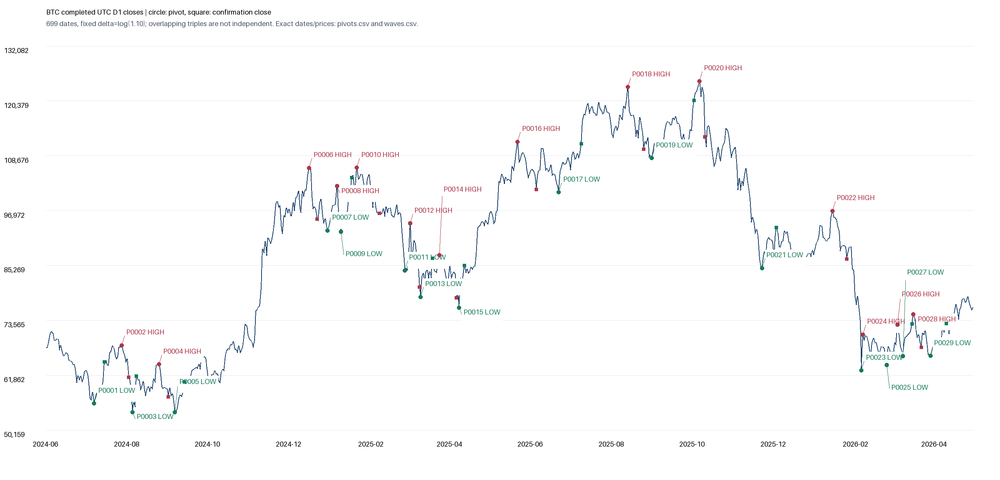

# Этап A: каталог дневных волн и интеграция аудита Astra

22 октября 2026. Согласованный этап A выполнен одним запуском. Полный период `[2024-06-01,2026-05-01)` сохранён: 699 дней плюс настоящий прогрев с 15 мая. Новых прогнозных меток, прогнозов, обучений или native backtests не было. Пилот, VPS, S0, CHECK и торговые настройки не затрагивались.

## Что принято из аудита

Архив `BTC_pattern_audit_Astra_20261022.zip` проверен, SHA256 `89f4ca537e1cca45f2b33325c1400353a392de2666d3f8c3932fadc5cae1b7a6`. Он описывает более раннюю базу b27dd2d; рекомендации сверены с фактическим HEAD1e33e40 перед изменениями.

| Находка | Фактическое решение |
|---|---|
| Прямая граница истории E1 | Уже исправлена вed943a8; повторного исправления/прогона нет |
| DAILY90 как следующий контроль | Уже завершён отрицательно в5e98d0c; не пересчитан |
| Совместимость свободных D и SL-touch вероятностей | Добавлен будущий вход `response_arrays_future`, использующий старый парсер и новые необходимые неравенства. Старые ответы/оценки сохранены |
| ru_maxrss на Linux/Darwin | Добавлена минимальная нормализация в байты и применена к исследовательскому guard |
| Строгая непересекаемость и причинная доступность | Сравнены числа доступных волн по заранее заданным контрактам, без прогнозов и выбора по результату |
| Положительный и нулевой синтетический контроль | Небольшие детерминированные unit fixtures через существующий численный retrieval/CDF/scoring; это проверка кода, не рыночного преимущества |
| Astra/max на6 старых окнах | Проверены хеши/12 ответов/5 агрегатов; маленькая повторная development-диагностика не дала нового победителя |
| Astra-ранжирование8 кандидатов, cap26 | Сохранено предложением следующего опыта, сейчас не запускалось |

В будущем при использовании свободных ответов моделей необходимо явно вызывать новый строгий вход; прежний архивный парсер остаётся доступным для воспроизведения исторической версии. Ограничения D/touch не переносятся автоматически на эмпирический D с отдельным исключением ambiguous-путей и другим знаменателем.

## Фактический каталог

Фиксированная разметка использует только закрытые D1 close и `δ=log(1.10)`. Она сохраняет экстремумы A→B→C, отдельные моменты их подтверждения и тогдашние доступные префиксы. Будущие C/D отсутствуют в текущих снимках. Порог не подбирался по качеству или длительности.

| Показатель | Значение |
|---|---:|
| Подтверждённые экстремумы |30|
| Последовательные тройки |28|
| Полностью наблюдённые тройки внутри периода |27:14 растущих /13 падающих |
| Обрезанные слева тройки |1|
| Полные коррекции, пересёкшие исходную точку A |15|
| Сохранённые старые H1 ID / оценочные ID |372 /198|
| Новые макроточки |30, включая2 с недостаточным начальным контекстом |
| Верхняя граница непересекающихся `[A,D]` среди всех полных волн |9|
| Та же граница среди20 завершённых волн оценочных периодов |6|

Последние показатели не являются количеством доказанно независимых наблюдений. Последовательные тройки разделяют ноги и пересекаются.8 ранних H1 ID предшествуют первому макроподтверждению и сохранены с явным отсутствием родителя. Все30 макроточек имеют24 закрытые H1-свечи и наблюдаемый по времени H72 горизонт; исходы не рассчитывались. Последняя волна остаётся незавершённой, C/D неизвестны.

### Длительность: цена и подтверждение — разные величины

| Интервал | Минимум | Медиана | Максимум |100–200 дней |
|---|---:|---:|---:|---:|
| A→C: фактический ценовой цикл |10д|29д|115д|3|
| A→D: до подтверждения завершения |19д|40д|123д|4|

Три ценовых цикла100–200 дней пересекаются; максимум непересекающихся `[A,D]` среди них —2. Подтверждение экстремума запаздывает на медианные8.5дня, максимум33дня, включая доступность D1-close в следующую полночь.

**Вывод по определению события:** порог10% в основном выделяет более короткие движения, чем предполагаемые крупные циклы100–200 дней. Он не подтвердил нужное определение большой волны. Нельзя объявить этот результат проверкой прогнозной полезности крупных циклов или автоматически повышать порог, чтобы получить желаемую длительность.

Кружки — экстремумы; квадраты — более поздние подтверждения. Переходы/подтверждения на графике видимы ретроспективно; их использование в исторических входах ограничено соответствующими временами доступности. Подробные цены и даты — в `run/pivots.csv` и `run/waves.csv`.

## Доступная историческая база

Старый OLD_STRICT требует зрелости до общей seed-границы15мая2024 и оставляет нулевую библиотеку. CAUSAL_WALK_FORWARD допускает общую уже известную прошлую историю, но требует зрелых исторических событий к фиксированному fit cutoff. Это не разрешает будущие закрытия, незрелые исходы или подгонку по оценочному результату. Здесь сравнивались только метаданные.

| Блок | Fit cutoff | Зрелых прошлых волн | Непересекающихся максимум |
|---|---|---:|---:|
| F1 |01.01.2025|4|2|
| F2 |01.07.2025|14|5|
| F3 |01.01.2026|19|6|

Исходные календарные границы не сдвигались. ВF3 последняя текущая волна не завершена; её запись не удалена. Более строгий CYCLE_DISJOINT из предыдущего предложения показан отдельно в выгрузках, не назван CAUSAL_WALK_FORWARD.

**Прогнозный переход не разрешён:** F1/F2 не достигают заранее зафиксированного инженерного минимума6 прошлых непересекающихся циклов. Этот минимум не является расчётом статистической мощности; даже его прохождение не доказывало бы достаточность данных. Дополнительно сама разметка в основном короче целевого большого цикла.

## Проверки, выполнение и следующий шаг

31 адресный тест прошёл. Независимая проверка выявила одну ошибку равенства порогу из-за округления логарифмов; она исправлена до расчёта вместе с приведением критериев допуска к согласованной спецификации. После исправления код и протокол зафиксированы в `b516de74c8e83e643b3d84263bfd08274506d32f`.

Один расчёт завершился exit0 за0.791с, peak RSS125.55MiB, без повторов. Независимая и координаторская проверки подтвердили699 дат, причинную привязку372/198 ID, времена H1, неизвестность будущих C/D, неизменность старых результатов и хеши. Графики просмотрены; читаемые варианты экспортированы из уже сохранённого каталога, без повторной сегментации.

Каталог SHA256 `f60c02dd558729317fd1a94d753e191f335ace498a0fbd4539a72a9837bfee37`. Полные артефакты, CSV, снимки префиксов и execution receipt — в `run/`.

Единый план — `PLAN.md`; сверка аудита — `audit-integration.md/json`. Следующие шаги остаются предложениями: согласовать соответствующее задаче определение крупной волны и достаточность истории, либо отдельно согласовать ограниченный Astra-reranking по аудиту с численным переводом ранга в TP/SL. Ни свободные вероятности Astra, ни26 модельных ответов, ни новый рыночный прогноз в этот пакет не добавлены. ROI/DD не оценивались, прогнозная полезность полных дневных волн остаётся неизвестной.
