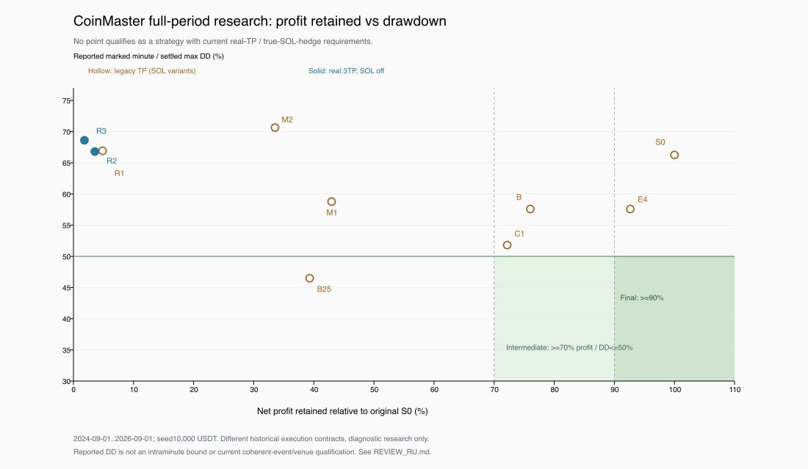

# CoinMaster — обзор четырёх недель и единый план

Срез 28.09–26.10.2026. Главный итог: квалифицированной стратегии с≥70% прибыли originalS0 / DD≤50% пока нет; финальные90% также не достигнуты. Пилот и production этим пакетом не менялись.

1. [Полный анализ: хронология всех найденных семейств, результаты, системные выводы](REVIEW_RU.md).
2. [Один актуальный план с прежними четырьмя задачами и дополнительными зависимостями](UNIFIED_PLAN_RU.md).
3. [Что уже начато после анализа и текущее решение](CURRENT_DECISION_RU.md).

График показывает сохранённые полные результаты на разных исторических контрактах, а не новый backtest или причинное сравнение. Пустые маркеры — legacyTP, синие — реальные3TP/SOLoff(R2/R3). Ни одна точка не прошла нынешнюю truehedge/realTP/coherentevent квалификацию. [SVG](full_period_frontier.svg), [точные plottedrows](full_period_frontier.csv), [код визуализации](plot_results.py).

## Доказательства

- Ранние20семейств: [анализ](EARLY_EVIDENCE.md), [регистр](EARLY_REGISTER.json).
- Экономические14семейств: [анализ](ECONOMIC_EVIDENCE.md), [регистр](ECONOMIC_REGISTER.json).
- Последние #132–136: [анализ](RECENT_EVIDENCE.md), [ledgers/failuretaxonomy](RECENT_REGISTER.json).
- [11AIнаправлений/проверок](AI_REGISTER.json), [51reportdirectories inventory](SCOPE_INVENTORY.json), [35GitHubissuesmetadata](PROJECT_SCOPE_ISSUES.json), [эксплуатационныйконтекст](OPERATIONAL_CONTEXT.md).
- [Независимая проверка обзора/плана](INTEGRATION_REVIEW.md), [две исправленные формулировки](INTEGRATION_REVIEW_CORRECTION_RECEIPT.json), [P0rootacceptance](P0_ROOT_ACCEPTANCE.json), [принятый до начала P1 snapshotплана](P0_REVIEWED_PLAN_SNAPSHOT.md).
- P1послеанализа: [SOL lifecyclecontract](P1_SOL_LIFECYCLE_CONTRACT.md), [growth/admission](P1_GROWTH_ADMISSION.md), [точечная actualR2coverageпроверка](P1_R2_COVERAGE_CHECK.md), [проверка нового conditionalпорядка](P1_DECISION_REVIEW.md), [ревизия плана](PLAN_REVISION_AFTER_P1.json).

Объёмы не складывать: family/variant/row/control/process/constructor — разные единицы. Общий счёт всех engines/часов/стоимости месяца UNKNOWN. Зарегистрированные последние32physicalclaims и36полныхattempts в8другихсемействах имеют собственные scope; nativeunit-tests и другие ранние попытки отдельно. Причинные dollars для альтернативных капитализаций не выдумывались. Отсутствующие результаты остались UNKNOWN/NOT_RUN.
