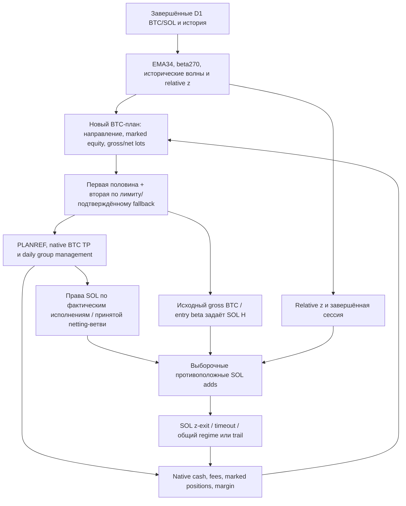

# S0: системный аудит BTC, SOL и портфеля

**Главный вывод:** S0 — объяснимый, но сильно связанный трендовый BTC-алгоритм с выборочным SOL-overlay и агрессивным реинвестированием. Это не BTC с постоянной страховкой. Глубокие просадки возникают из разных механизмов: убыточный/слишком большой SOL против уже прибыльного остатка BTC; самостоятельный SOL после BTC; BTC без SOL на развороте; накопленная серия реализованных потерь. Одно постоянное уменьшение SOL, более близкий TP или одинаковый SL не устраняют все четыре механизма. Сохранённые полные прогоны подтверждают эту неоднородность.

Цель **DD≤50% и ≥90% чистой прибыли S0 пока не достигнута**. Ни научные источники, ни этот аудит не доказывают, что она достижима при неизменных входах/размерах и доступных BTC/SOL-инструментах. DD30% — более строгая исследовательская цель, а не обещанный результат.

## 1. Что именно проверено

Точный S0: source `75ffc9c69e9d79c4da4cd0614634a3eeba48d716`, config `22e1eefe8f9c71669e52a8e44b7acbdfd5f177d6ef4ae2118e9df566a05c6edc`, data `7ab5ae2cdaa14885da28d188c7ad14dfc8168ee600b78535f7317409ea94e9cc`. Сверены **72/72 source pins**, хеш сохранённого результата, ключевые ветви signal/domain/native adapter/margin. Это не текущая ветка с дополнительными экспериментальными флагами и не приблизительная сборка по параметрам старого победителя.

Период `[2024-09-01,2026-09-01)`, старт10000USDT, RESERVE0, DPoff. S0: TOTAL **6077107.23887483**, ROI **60671.0723887483%**, settled-minute DD **66.2569148647%**, fees **945927.73761825**, BTC/SOL fills **416/205**. Критерий прибыли:

`TOTAL >= 10000 + .9 * (6077107.23887483 - 10000) = 5470396.514987347`.

Новых native-прогонов, пересчёта S0, ML-обучений, изменения исходников стратегии, пилота, сервисов, ключей, ордеров или deployment **не было**. Выполнены чтение точного кода, сохранённых результатов, научный поиск и арифметические проверки. Текущее здоровье пилота этим аудитом не проверялось. Это широкий аудит активной экономической логики; он не является формальным доказательством отсутствия любых ошибок во всех возможных внешних состояниях.

Подробности и доказательства: [BTC](btc-audit.md), [SOL](sol-audit.md), [реестр экспериментов](experiments.md), [JSON источников](sources.json), [расчёты](method-calculations.json).

## 2. Структура алгоритма и цепочка последствий

Последняя стрелка критична: изменение SOL сегодня меняет капитал, BTC-объёмы и права завтра. При неизменных BTC-сигналах могут сильно измениться BTC PnL и DD. Поэтому нельзя улучшать старую equity простым удалением плохих fills.

### BTC от входа до завершения

1. Завершённый D1 close относительно EMA34 задаёт сторону. Beta и минимальное число завершённых волн — gates, а не дополнительное подтверждение качества входа.
2. Плановый gross notional — marked active equity × **5.5 для long / 7.875 для short**, максимум30млн. Это размер позиции, а не процент допустимого убытка и не выставленное бирже плечо.
3. В selective zero-netting части нулевых TP не открываются там, где прежняя цель была бы пассивным немедленным закрытием. В другой ветви сохраняется реальная позиция и последующий выгодный fallback. Исходный gross reference для SOL при этом сохраняется.
4. Принятый net-план делится примерно50/50: первая часть, вторая — лимитом на **0.25%** лучше первой; крайний срок4h/граница дня. При раннем касании положительной цели возможен cancel/ACK/IOC остатка. Неизвестный ACK остаётся собственным незавершённым исполнением.
5. **PLANREF** фиксируется по завершённой первой части. TP/сопровождение используют эту опору; native деньги и средняя позиции используют фактические исполнения обеих частей.
6. TP-доли **21.25/21.25/57.5%**, уровни — квантили **10/30/60%** благоприятного движения исторических завершённых D1-волн. Положительные resting TP и выгодный IOC catchup — разные реальные исполнения с разными комиссиями.
7. Противоположный D1 regime закрывает группу. Daily trail включается только после благоприятного close-return **строго больше3%**, затем реагирует на откат на3 процентных пункта. **Начального SL3% здесь нет; непрерывного intraday trail3% также нет.**
8. Group-flat требует native flat и завершения собственных orders/pending. При REGIME допускается новая переоценка той же принятой daily-сессии; другие повторные входы имеют свою последовательность. BTC-flat не обязательно означает group-flat: SOL может продолжать жить.

### SOL от права до закрытия

1. SOL не открывается постоянно вместе с BTC. Нужны соответствующее право и relative z-сигнал, сторона противоположна стороне исходного BTC-эпизода.
2. Beta оценивается на **270 завершённых D1 logreturns**; relative-window65d и z-history180d. Это относительная доходность, а не отдельный подтверждённый разворот SOL на15m/1h.
3. `H = gross_reference_BTC_qty * actual_blended_BTC_VWAP / entry_beta`. **H не следует автоматически за остатком BTC.**
4. Уровни z **1.25/2.5/3.75**, размеры доборов **1.75H/2.625H/3.5H** — отдельные добавки, не последовательные целевые остатки. Сумма при всех fills до ограничений маржи — **7.875H**.
5. Фактические права/ownership не подменяются submits. Однако экономическая привязка к BTC-фиксациям/netting-ветви не означает привязку к текущей потребности в страховке.
6. Sigma фиксируется на первом SOL-fill; обычные z-выходы используют0.375/0.125, timeout14d; общие REGIME/TRAIL могут закрыть группу. SOL-only после BTC-flat допустим исходной стратегией.

Полные формулы, приоритеты, переходы и ссылки на строки точного commit находятся в отдельных BTC/SOL-аудитах. Большое число неактивных research-флагов в общем исходнике не означает, что они одновременно торговали в S0.

## 3. Что полезно, что выбрано подбором, что проблемно

| Слой | Разумное основание / подтверждённая польза | Неподтверждённое или проблемное |
|---|---|---|
| Завершённые D1, causal wave catalogue | Определённый момент принятия решения, отсутствие незавершённого сигнала | EMA34, окна730/270/65/180 и min8 не доказаны оптимальными или устойчивыми вне просмотренной истории |
| Native execution / pending ownership | Реальные fills, lots, cancel/ACK, margin, отсутствие фиктивного PnL | Это правильность исполнения, а не доказательство доходности сигнала |
| PLANREF и positive IOC | Измеренное улучшение исполнения; узкий переход PLANREF→IOC дал +71619.43TOTAL | Положительная формульная цель не гарантирует положительного net после обеих комиссий; это улучшение уже входит в S0 |
| Split entry | Объяснимый обмен между лучшей ценой и срочностью исполнения | 50%,25bp,4h и adverse catchup не имеют независимой гарантии; дешёвая лимитная половина может смениться дорогим догоном |
| Квантили TP | Историческая адаптация вместо произвольных расстояний | D1 OPEN/CLOSE-волна не равна actual PLANREF/1m entry; низкие квантили содержат нули, малое число волн даёт нестабильность |
| TP-права SOL | Каузальная связь двух частей стратегии | Почему именно BTC-фиксация должна разрешать SOL alpha/страховку — отдельная непроверенная экономическая гипотеза |
| SOL relative z | Объяснимая relative-value/mean-reversion гипотеза | Это не гарантия возврата; adverse adds увеличивают риск. 1.75/2.625/3.5 и exit/timeout подобраны на истории |
| SOL H от gross BTC | Сохраняет исходную шкалу overlay при selective netting и TP | После сокращения BTC превращает «хедж» в самостоятельную, иногда доминирующую ставку |
| Daily regime/trail | Выход из сменившегося режима, фиксация части развитой прибыли | Нет начального ограничителя потерь; daily реакция пропускает intraday падение, серия переоткрытий может реализовывать убытки |
| Margin/maintenance | Ограничивает допуск и запускает модельную ликвидацию | Не ограничивает DD50 и не валидирует исторические venue tiers/очередь/gap/liq fees |
| Реинвестирование | Главный усилитель роста капитала | Усиливает ошибки раннего сопровождения и меняет последующий риск после любого вмешательства |

Нельзя достоверно приписать каждому числу «бездумное намерение Codex». Можно проверить более важное: есть ли механизм, адресная абляция, полная native-экономика, соседняя устойчивость и независимая проверка. У значительной части численных настроек есть только выбранный хороший результат на уже исследованной истории. Это **selection/overfit risk**, не статистически доказанная случайность каждого параметра.

### Нулевые BTC TP: не удалять вторично уже исправленное

В точном S0 приняты105 BTC parents;45 passive zero-netting ветвей и60 full/fallback. Уже пропущены45 TP1 и31 TP2 allocation. В сохранённом пути нет BTC reductions в ту же временную точку, что первый вход или завершение split. Из155 BTC reductions73 generic; их нельзя все переименовать в нулевые TP: полные frozen wave vectors FULL-ветви не выгружены. Реальные generic reductions были позже и прибыльны по диагностической net-атрибуции ex funding.

Следовательно, ранняя проблема пилота «два TP по входу» не переносится автоматически на точный S0. Принудительно сделать все три цели положительными или убрать все generic fallback — новая экономическая политика, уже имеющая отрицательные контрпримеры. Семь из13 positive TP2 IOC catchups fee-negative, но локальный убыток не доказывает вред всей политики. **Их не удаляли.**

## 4. SOL — alpha, страховка или источник риска?

**В S0 — выборочная alpha с эпизодическим эффектом страховки.** SOL присутствует только в **15.37844% времени удержания BTC** по исходной fill-интервальной диагностике. Сам факт присутствия ещё не означает достаточное покрытие. После BTC-flat SOL может остаться без того, что требовалось страховать.

Худшая просадка: peak13426.6743→trough4530.5741USDT, **66.2569%**, 14.09→03.10.2024. В trough:

- BTC-short0.724; mark-notional **−43591.99656**, сохранённые native OHLC bounds openPnL **+475.85…+530.00**.
- SOL-long810.9; mark-notional **+107984.3094**, native bounds **−5619.54…−5165.43**.
- По зафиксированной beta входа1.17995003456 SOL соответствует **292.2924% оставшегося BTC**, net beta-exposure **+83824.09**, около18.50× текущей equity. Gross/W≈33.46×.

Это расчёт экспозиции по исходной fitted beta, **не наблюдённая будущая beta или обещанная компенсация**. Направление риска стало противоположным BTC-шорту. При этом содержащий эту просадку SOL-cycle позже закрылся **+2330.72** ex funding: прибыльная завершённая сделка может иметь неприемлемый внутрисделочный риск.

Второй пример: 31.12→01.01 BTC уже отсутствует; SOL gross/W вырос **7.415→13.290×**, native открытая прибыль сократилась **80370→1294.544**. Это самостоятельный SOL-риск и отдача накопленной прибыли, а не работа страховки BTC.

Диагностическая fill-атрибуция всего победителя: BTC **+5345694.49**, SOL **+678661.21** после распределённых комиссий, без распределения funding; bridge42751.54 остаётся нераспределённым. Поэтому текущий S0 нельзя описывать как «почти вся прибыль от SOL». Но и BTC-only TOTAL280748.52 нельзя вычитать из S0 и называть остаток SOL PnL: удаление overlay меняет ранний капитал и все будущие размеры. Эти две оценки отвечают на разные вопросы.

### Почему коэффициента волатильности недостаточно

В одношаговой линейной модели доходностей hedge-notional на единицу BTC, минимизирующий дисперсию:

`h* = Cov(rBTC,rSOL)/Var(rSOL) = rho * sigmaBTC/sigmaSOL`.

При betaSOL|BTC=`Cov/Var(rBTC)` обратная beta равна `sigmaBTC/(rho*sigmaSOL)`, а `h*/(1/beta)=rho²`. **Обратная beta, нейтрализация общего фактора и минимум дисперсии — разные задачи.** Текущий H ещё умножается на alpha multipliers и не следует за остатком BTC. Даже корректный minimum-variance cross-hedge оставляет basis risk; он не гарантирует максимум DD. Формула применима как модель/диагностика, не как готовая profitable replacement policy. [Авторский разбор cross-hedge](https://mingze-gao.com/posts/minimum-variance-hedge-ratio/index.html).

## 5. Откуда берётся DD: разные механизмы требуют разных действий

Сохранённая T+V endpoint-атрибуция имеет cutoff08.04.2026; глобальный24m максимум подтверждён отдельной полной completion. Нельзя выдавать эти5 событий за исчерпывающий список всех24m drawdowns.

| Эпизод | DD | Что наблюдается | Дефицит до50% от прежнего peak | Fees peak→trough |
|---|---:|---|---:|---:|
| Сентябрь→октябрь2024 |66.26%|BTC-short в плюсе, более крупный SOL-long в минусе; также реализованные потери пути|2182.76|244.56|
| Апрель→июнь2025 |59.84%|В trough BTC-only short; значительная часть падения уже в cash|90078.22|25108.05|
| Октябрь→ноябрь2025 |55.10%|BTC-only squeeze, cash немного вырос, просела открытая позиция|106523.66|32537.27|
| Декабрь→январь |42.17%|SOL-only отдаёт накопленную открытую прибыль|0|71.43|
| Январь→февраль2025 |40.27%|BTC-long; ухудшение открытого результата|0|6272.95|

У первых трёх fees составляют лишь **2.75/4.58/2.83%** фактического падения peak→trough. На неизменных endpoint-снимках даже все эти fees меньше дефицита до50%-floor. Это показывает масштаб проблемы цены/экспозиции, **не рассчитывает новую fee-free стратегию**: у неё изменились бы реинвестирование и будущий путь.

Отдельный вывод сохранённых экспериментов: уменьшая целевую раннюю DD, новая политика часто переносит худший максимум на лето2026, где раньше50% проходилось. «Защитили самый плохой октябрь» не равно «защитили весь портфель».

## 6. Какие методики найдены и действительно опробованы

| Метод | Что сделано без новых торговых прогонов | Численный/проверяемый результат | Применимость |
|---|---|---|---|
| Идентичность и state-machine audit | Проверены72source pins, active flags, переходы BTC/SOL/group, деньги против management-reference | Найдены неверные трактовки beta720h, только2TRAIL и отсутствующей liquidation model | Обязательный дешёвый первый шаг; предотвращает оптимизацию не той стратегии |
| Механистическая абляция | Сопоставлены существующие полные native outcomes; invalid/partial/AI отделены |15 сопоставимых полных settled-DD путей, ни одного50/90 | Полезно для отсечения неработающих семейств, не доказывает универсальный запрет идеи |
| Ограниченная многокритериальная оптимизация | Сначала profit-floor, затем DD, затем TOTAL; Pareto по сохранённым фактам | Frontier **S0/E4/S**; E4 лучшее снижение DD среди сохраняющих90% прибыли | Это честный screening известных вариантов, не новый оптимальный алгоритм |
| Факторный анализ взаимодействий | Найдены полные сохранённые2×2 клетки общего source/base дляE4×Z иE4×S |TOTAL interaction **+1350163.68** и **+241136.25**; оба сочетания всё равно хужеE4 | Реально полезнее независимого подбора: величины эффектов не складываются |
| Риск-атрибуция и headroom | Native cash/UPnL bridges, конкретные book exposures, дефицит доfloor |Различены SOL-overhedge, SOL-only, BTC-only squeeze, cash-loss sequence | Позволяет выбрать управляемое действие; не создаёт counterfactual equity |
| Проверка миграции риска/восстановления | Сохранённые непрерывные high-water excursions и фиксированные окна |R2C: октябрь49.94/январь49.41, но global61.76; earlyTP3: ноябрь43.87, но global61.08 | Обязательна; один любимый эпизод не является acceptance |
| Sensitivity/robustness screening | Старые соседние размеры/интенсивности, без новой сетки |M1 trim50%→M2 trim75% ухудшает DD58.77→70.64 и profit42.95→33.54% | Отсутствует монотонная «сильнее режем — безопаснее» зависимость |
| Защита от selection bias | Зафиксирован повторно использованный период и неполный universe проб |Нельзя корректно получить PBO/DSR/доверительный интервал из TOTAL+maxDD | Метод применим как дисциплина, численное PBO сейчас **не вычислялось** |

[NIST](https://www.itl.nist.gov/div898/handbook/pri/section3/pri33.htm) разделяет screening и поиск локальной поверхности отклика. [JRC](https://joint-research-centre.ec.europa.eu/sensitivity-analysis-samo/methods_en) прямо описывает ограничение one-at-a-time: взаимодействия остаются невидимыми. Здесь применён анализ уже существующих2×2 outcomes, без дорогого нового факторного эксперимента. Полная тройная interaction и сочетание earlyTP3×SOLbudget неидентифицируемы: необходимых клеток нет, они не выдуманы.

[Kaminski/Lo](https://dspace.mit.edu/entities/publication/bb69ca4b-0cdc-487f-831d-63b2e84fafee) рассматривают условную ценность stop rules, а не универсальное преимущество более тесного SL. [Drawdown feedback control](https://arxiv.org/html/1710.01503v1) связывает позицию с оставшейся подушкой при **ограниченных returns**. Это полезный принцип, но не готовое доказательство DD50 на крипто-перпах с gap/latency/fees и cross-hedge.

[Исследование PBO](https://escholarship.org/uc/item/4w1110bb) и [прямое интервью Carver](https://www.toptradersunplugged.com/podcast/266-systematic-investor-series-ft-rob-carver-october-21st-2023/) объясняют риск многократного ручного отбора на той же истории. Статистический диагноз требует полного selection universe и сопоставимой return matrix; их отсутствие не исправляется красивой метрикой. Sharpe не добавлялся в критерий выбора.

Официальный [форум QuantConnect](https://www.quantconnect.com/forum/discussion/8483/stop-loss-take-profit-on-algorithm-framework/) полезен как конкретный пример конфликта: risk close и продолжающийся alpha-сигнал способны немедленно переоткрывать риск. Это применимо к проверке нашего rearm/ownership, но не повод добавлять отдельный risk-сервис. [Официальная документация Nautilus](https://nautilustrader.io/docs/latest/concepts/backtesting/trade-execution/) подчёркивает роль реального execution evidence. Latest API не объявлены возможностями pinned S0; активный исторический код проверен отдельно.

**Не выбраны для немедленного применения:** ещё один ML-recognizer, большой Bayesian/grid search, генетический подбор десятков параметров, новый wave-catalogue и Monte Carlo с перемешанными fills. Сейчас они увеличивают свободу подбора или нарушают причинный portfolio lifecycle быстрее, чем устраняют обнаруженные механизмы.

## 7. Что показали все прошлые экономические эксперименты

| Вариант | TOTAL | Сохранено прибыли S0 | Global settled DD |
|---|---:|---:|---:|
|S0|6077107.24|100.00%|66.26%|
|B|4622034.27|76.02%|57.59%|
|E4|5631617.36|92.66%|57.59%|
|S|4155625.78|68.33%|57.15%|
|E4+S|5406345.12|88.94%|58.95%|
|M1|2615745.21|42.95%|58.77%|
|M2|2044863.63|33.54%|70.64%|
|Residual SOL R2C|2610652.32|42.86%|61.76%|
|E4 SOL budget|1360086.37|22.25%|66.86%|
|E4 early BTC TP3|4120806.47|67.76%|61.08%|

Полная таблица15 сопоставимых вариантов, старые иные observers/bases,78 недельных записей,31 строка поздних сравнений, исключённые результаты и source pins — в [experiments.json](experiments.json). Не все эти записи — независимые native-прогоны: повторы, исправления и общие контроли не удваивают экономическое доказательство.

Выводы:

- **Полезно:** восстановление своевременного reentry в E4 улучшило B на1009583.09 без роста его worstDD. Это конкретное подтверждённое действие, а не новое семейство предикторов.
- **Не работает как общий рецепт:** постоянное SOL-страхование вместо alpha, безусловный срез losing leg, tighter trims, удаление zero/fallback exposure и ранний постоянный TP. У отдельных окон эффект есть, полного50/90 результата нет.
- **Не доказано:** что SOL вообще не нужен; что любое уменьшение размера обречено; что любой intraday stop плох; что новая state-aware политика не может помочь. Проверенные конкретные варианты не дают таких универсальных выводов.
- **Состояние цели:** у E4 остаётся **161220.84455USDT** запаса над profit-floor, а DD надо уменьшить ещё на **7.5854п.п.**. Это узкий компромисс; слово «чуть подправить» экономически не обосновано.

## 8. Где искать улучшение дальше: конкретный системный порядок

Это **предложение следующего протокола**, не реализованная новая политика и не разрешение запускать её.

### P0. Исправить описание и обеспечить достаточные свидетели решений

Не менять стратегию, чтобы привести выводы в порядок: active beta270D1, а не неактивный720h;2BTC TRAIL fills не равны всемgroup TRAIL (**39SOL TRAIL fills**); модель maintenance/liquidation есть, label устарел. Сохранять per-decision frozen wave vector/count/IDs, PLANREF/actualVWAP, gross/net/remaining BTC, конкретный SOL-right, native marked money, знаковый funding и group-close reason. Использовать существующие журнал/проекции, без второго исполнителя и нового risk-сервиса. В новых экономических прогонах это необходимый evidence contract; просто переименовать UI/лог не значит изменить экономику.

### P1. Сначала отделить риск от alpha, сохранив исходный вход

В том же domain/native executor различать **три управляемых состояния**, а не добавлять три независимые стратегии:

1. **BTC против движения, SOL отсутствует/мал:** риск чисто BTC. Изучать остаток после реальных TP и непрерывный joint loss cushion; не резать всю initial позицию одинаковым2%SL.
2. **SOL beta-доминирует или BTC-flat:** риск самостоятельного SOL. Объём страховки определяется реальным остатком BTC; превышение — явно отдельный alpha-риск, которому нельзя автоматически приписывать полезную страховку.
3. **Потери уже реализованы:** stop открытой позиции не вернёт cash. Важны повторный вход/размер новой экспозиции; сохранять timely E4 rearm как проверенный ориентир, а не бесконечный cooldown.

Это аналитическое разделение назначений и состояния, а не предложение немедленно обрезать всё сверх100%beta. Столь простой cap уже противоречит данным о потере прибыльных восстановлений. Нужны поведение восстановления, hysteresis/rearm, максимальный повторный риск и комиссия в полном lifecycle до выбора числа.

### P2. Выбрать только одно новое управляемое решение

Наиболее обоснованная область — **изменяемый оставшийся риск в опасном состоянии и цена обратного восстановления**, а не очередной постоянный early TP/безвозвратный trim. Предыдущие сокращения теряли последующее участие; поэтому новизна обязана состоять в причинно определённом условии безопасного возврата риска, а не в новом проценте среза.

До прогона по всем календарным периодам, включая удачные вмешательства и false positives, определить: observable trigger; affected native leaves; запрет дублирующего восстановления; действие при incomplete cancel/ACK; что происходит с SOL entitlement; hysteresis и предел частоты; ранний выход/возврат; стоимость missed recovery. Если этих свидетелей в старом архиве нет, достаточность screening ограничена. Нельзя утверждать, что известен прибыльный threshold или выдать price-only screen за новый TOTAL.

Две исследовательские ветви ранжированы так: **A — joint residual exposure с event-driven, ограниченным восстановлением**, **B — качество исполнения второй BTC-половины/positive fallback**, если A не даёт достаточной точности. B не должна задерживать BTC так, что исчезает прибыльный тренд; обязательный контроль — исходный S0 split при той же исполняемой политике. Не запускать их одновременно и не менять десятки параметров.

### P3. Малый заранее зафиксированный дизайн, а не бесконечные четыре новые идеи

После отдельного согласования: неизменные архивы S0/E4; максимум несколько кандидатов с **одним** контрактом риска. Если нужны два фактора,2×2 клетки должны иметь общую исходную версию; недостающие клетки не заменяются разными базами. Полный portfolio native path обязателен: real quantities, rights, funding, cash, mandatory exits, restoration costs. Триггеры по времени и цене нельзя выбрать на конкретных датах уже известных trough.

Acceptance: TOTAL≥5470396.514987347; непрерывная global DD≤50%, затем MAX_TOTAL; все фиксированные стресс-окна и остальные месяцы, нет новой непокрытой DD, полная выгрузка, native money/fee bridges/flatness, отдельный engine/journal. Не объявлять хорошим результатом уменьшение DD ценой половины прибыли. При отрицательном результате остановить семейство, не расходовать новый бюджет на косметически другой порог без нового механизма.

### P4. Отдельно доказать исполнимость и переносимость

Не считать гипотезу принятой для live только потому, что она выиграла на многократно просмотренной истории. Заморозить её, проверить последующие данные и фактический Hyperliquid-контур с его depth/mark/funding/margin/минимальными lots. Точный исторический S0 сохранить; отдельно измерять цену реалистичных fills, а не незаметно переписывать старую baseline. Новая большая инфраструктура/venue не требуется для текущего аудита, но Bybit-close модель не становится HL-live доказательством.

## 9. Существенные ограничения, которые нельзя скрывать за ROI

1. S0 сам помечен **NOT_FAITHFUL_DIAGNOSTIC**, ranking-eligible=false: synthetic executable quotes по1m CLOSE, zero adverse spread, noL2/trade-tape evidence. Это не утверждение, что данные поддельные: исторические prices реальны, **bid/ask/liquidity модельные**.
2. Mark CLOSE и trade CLOSE различны. Settled-minute DD не является максимальным intraminute/tickDD; OHLC bound тоже не доказывает исполнимый порядок экстремумов двух активов.
3. В source действительно есть native margin module и diagnostic maintenance close/lockout. Текущие captured tiers и модель не доказывают историческую биржевую liquidation-механику.0model liquidation не означает «на бирже ликвидаций не было бы».
4. Funding1320postings не равны известному signed aggregate: journal сохранил post-account totals, signed asset funding **UNKNOWN**. Никакого повторного funding-posting или замены UNKNOWN нулём не делалось.
5. TOTAL включает явное boundary-settlement **+86598.23876039** к interval cash5990509.00011444; один BTC-close на exclusive boundary. Сравнения обязаны сохранять эту конвенцию.
6. Разбивка просмотров на новые T/V/U не делает уже исследованную историю свежим OOS. Пока нет достаточной картины всех попыток/независимой статистики для гарантии будущей доходности.

**Результат аудита:** объяснена активная логика, отделены engineering repairs от экономического edge, выявлены несколько независимых источников риска и ошибки прежних трактовок. Лучший сохранённый компромисс — E4, но50/90 не выполнено. Следующее изменение надо строить вокруг residual-risk/recovery решения с полным causal lifecycle, а не вокруг постоянного SOL-хеджа, более близких TP или нового предиктора. Никакое такое изменение сейчас не реализовано и не запущено.
