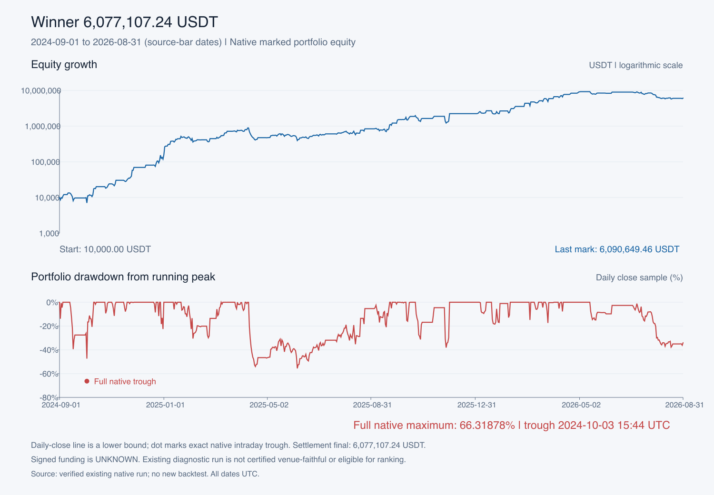
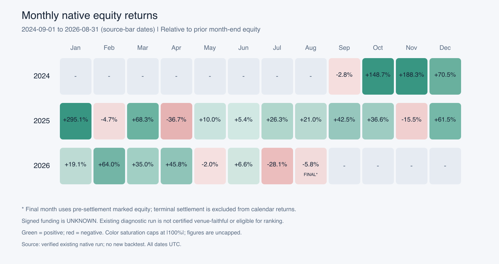

# Статистика точного результата 6 077 107,23887483 USDT

Сохранённый результат предыдущего запроса владельца. Начальный капитал **10 000 USDT**, период **[2024-09-01, 2026-09-01), UTC**, 730 дней. Итог после фактического закрытия на границе: **6 077 107,23887483 USDT**, прирост **60 671,0723887483%**. Это статистика уже существующего запуска; исходный статус `NOT_FAITHFUL_DIAGNOSTIC`, `ranking_eligible=false` сохранён. Эти числа не утверждают готовность реальной торговли.

## Графики

[Капитал и просадка — PNG](charts-equity-drawdown.png) · [SVG](charts-equity-drawdown.svg) · [Доходность 24 месяцев — PNG](charts-monthly-returns.png) · [SVG](charts-monthly-returns.svg).

**Линия DD на дневном графике — нижняя оценка по дневным закрытиям.** Точная максимальная просадка по всем сохранённым native-фазам **66,31878024969152%**, её точка показана отдельно. Дневную линию нельзя подставлять вместо полной native-просадки.

## Сделки и результаты активов

Сделка — непрерывная native-позиция одного актива от нуля до нуля. Добавления и частичные TP не создают новые сделки. **105 BTC-сделок точно совпали со 105 strategy-parent эпизодами; SOL — 26 сделок**, всего 131. Все 621 строки исполнений сопоставлены с native CSV по времени/инструменту/количеству/цене; проверены стороны, native maker/taker, комиссии и баланс количеств. Денежная атрибуция переиспользована из существующего отчёта, а не рассчитана новым движком.

| Группа | Сделки | Победы | Убытки | Ноль | Победы % | Gross USDT | Комиссии USDT | Net без funding USDT | Net PF |
|---|---:|---:|---:|---:|---:|---:|---:|---:|---:|
| Все | 131 | 79 | 52 | 0 | 60.3053 | 6,970,283.43 | 945,927.74 | 6,024,355.70 | 1.624986 |
| BTC | 105 | 57 | 48 | 0 | 54.2857 | 6,273,361.45 | 927,666.96 | 5,345,694.49 | 1.567544 |
| BTC LONG | 53 | 25 | 28 | 0 | 47.1698 | 344,982.65 | 408,261.77 | -63,279.12 | 0.988807 |
| BTC SHORT | 52 | 32 | 20 | 0 | 61.5385 | 5,928,378.80 | 519,405.19 | 5,408,973.61 | 2.436459 |
| SOL | 26 | 22 | 4 | 0 | 84.6154 | 696,921.99 | 18,260.78 | 678,661.21 | 4.082165 |
| SOL LONG | 13 | 11 | 2 | 0 | 84.6154 | 149,677.64 | 7,086.66 | 142,590.98 | 2.018275 |
| SOL SHORT | 13 | 11 | 2 | 0 | 84.6154 | 547,244.35 | 11,174.13 | 536,070.22 | 7.687679 |

**BTC-attribution не является результатом самостоятельного BTC-only запуска.** У BTC/SOL общий капитал, размеры и путь компаундинга. Доли доходности активов не складываются в ROI портфеля. Funding по активам и сделкам неизвестен.

| Актив | Средний net | Медиана net | SD net | P10 net | P90 net | Медиана удержания, ч | P90 удержания, ч | Gross PF |
|---|---:|---:|---:|---:|---:|---:|---:|---:|
| BTC | 50,911.38 | 2,664.74 | 366,439.51 | -345,830.13 | 610,238.68 | 47.98 | 143.98 | 1.701932 |
| SOL | 26,102.35 | 11,180.31 | 81,691.18 | -16,873.79 | 67,460.49 | 108.00 | 275.63 | 4.220378 |

Полные распределения PnL, процентов к накопленному входному номиналу, времени удержания и размеров, отдельные LONG/SHORT, top-10 выигрышей/убытков с ценами, количествами, комиссиями и причинами: [подробный отчёт сделок](trades-report.md), [JSON](trades-statistics.json), [весь реестр 131 сделки](trades-ledger.csv). Взвешенная доходность определена как сумма net без funding / сумма всех входных номиналов; это не ROI капитала или маржи.

## Серии и отдельные потери

| Группа | Максимум побед подряд | Максимум убытков подряд |
|---|---:|---:|
| Все | 9 | 7 |
| BTC | 7 | 7 |
| BTC LONG | 6 | 6 |
| BTC SHORT | 12 | 7 |
| SOL | 10 | 1 |
| SOL LONG | 9 | 1 |
| SOL SHORT | 6 | 1 |

Порядок серий — по окончательному закрытию сделки; ноль прерывает серию. Серии LONG/SHORT считаются внутри выбранной стороны и пропускают сделки другой стороны.

- Худшая BTC-сделка **#88 LONG**, 15–18 мая 2026: **−1 345 480,58753225 USDT**, комиссии 26 996,68823225; **−4,490552%** входного номинала; причина REGIME.
- Худшая BTC-серия **#97–103**, семь убытков подряд, закрытия 27 июля–18 августа 2026: **−2 770 141,73682905 USDT**. Это сумма закрытых сделок, а не просадка native equity.
- Худшая SOL-сделка **#24 LONG**, 20 мая–3 июня 2026 00:11 UTC: **−120 525,836 USDT**, комиссии 1 045,836; **−11,927346%** входного номинала. 14 дней 11 минут; 12 входных и 12 выходных исполнений HARD_TIMEOUT составляют одну сделку.
- Крупнейшие выигрыши: BTC #76 **+1 044 250,43341202**, SOL #22 **+364 042,0265 USDT** без funding.

BTC финальные закрытия: REGIME 48, BTC_TP3 39, BTC_REDUCE 15, TRAIL 2, terminal settlement 1. SOL: REGIME 13, TRAIL 11, Z_FULL_EXIT 1, HARD_TIMEOUT 1. Частичные исполнения и финальные обнуления разделены в [таблице причин](trades-exit-reasons.csv); несколько исполнений одного timestamp могут выполнять одно решение стратегии.

Полного журнала заработанных/потраченных/освобождённых SOL-прав нет: cover audit пуст. Сохранены 45 явно записанных zero-level activation events, уровни 0/1 встречаются 45/31 раз; [исходные строки прав](trades-archived-sol-rights.csv). Причины исполнений не доказывают полную причинную историю прав.

## Просадка native equity

| Пик UTC | Equity пика | Дно UTC | Equity дна | DD % | DD USDT | Восстановление UTC |
|---|---:|---|---:|---:|---:|---|
| 2024-09-11T14:00:00+00:00 | 13,451.34 | 2024-10-03T15:44:00+00:00 | 4,530.57 | 66.318780 | 8,920.76 | 2024-10-11T02:53:00+00:00 |
| 2025-04-11T01:00:00+00:00 | 915,175.73 | 2025-06-06T15:17:00+00:00 | 367,509.65 | 59.842724 | 547,666.08 | 2025-08-24T19:38:00+00:00 |
| 2025-10-22T21:29:00+00:00 | 2,088,471.56 | 2025-11-28T14:28:00+00:00 | 937,712.13 | 55.100556 | 1,150,759.44 | 2025-12-01T04:10:00+00:00 |

Максимальная потеря в деньгах: **3,818,310.33 USDT / 40.785591%**; пик 2026-07-06T13:39:00+00:00 (9,361,910.10), дно 2026-08-18T03:33:00+00:00 (5,543,599.77); к концу интервала не восстановлена.

Минимальный капитал **4 530,57414701** — это **−54,69425853% от стартовых 10 000**, отдельная величина от DD 66,31878% относительно достигнутого пика. Условная OHLC-граница 67,54771032% не является доказанным intrabar-путём.

**Время ниже глобального HWM всех native-фаз: 99,6486872146%**, 727,4354167 дня. При отдельном paired-minute sampling и его собственном HWM: **89,4516742770%**. Разные наблюдения дают разные пики; эти показатели нельзя заменять друг другом. Самый длинный native-период ниже HWM: 135,7756944 дня. Полные 1 223 эпизода, top-10, rolling-стресс и дневные/недельные показатели: [отчёт риска](risk-statistics.md), [JSON](risk-statistics.json), [все DD](risk-drawdowns.csv).

## Календарные 24 месяца

Native NAV включает открытый marked PnL; одна paired-проба на исходную минуту, месяцы UTC. Последняя точка августа — капитал **до** terminal settlement. Monthly DD — максимум внутри месяца на paired-пробах; это отдельная метрика от полной global native DD.

| Месяц | Начальный NAV | Конечный NAV | Изменение USDT | Доходность % | DD месяца % |
|---|---:|---:|---:|---:|---:|
| 2024-09 | 10,000.00 | 9,715.42 | -284.58 | -2.8458 | 47.8657 |
| 2024-10 | 9,715.42 | 24,159.93 | 14,444.51 | 148.6761 | 60.4751 |
| 2024-11 | 24,159.93 | 69,642.58 | 45,482.65 | 188.2566 | 30.7026 |
| 2024-12 | 69,642.58 | 118,744.23 | 49,101.65 | 70.5052 | 37.9746 |
| 2025-01 | 118,744.23 | 469,130.45 | 350,386.21 | 295.0764 | 24.0543 |
| 2025-02 | 469,130.45 | 446,870.02 | -22,260.42 | -4.7450 | 32.3012 |
| 2025-03 | 446,870.02 | 751,876.81 | 305,006.79 | 68.2540 | 17.8812 |
| 2025-04 | 751,876.81 | 475,637.29 | -276,239.52 | -36.7400 | 56.5815 |
| 2025-05 | 475,637.29 | 523,051.51 | 47,414.22 | 9.9686 | 29.6059 |
| 2025-06 | 523,051.51 | 551,390.87 | 28,339.36 | 5.4181 | 33.3360 |
| 2025-07 | 551,390.87 | 696,176.48 | 144,785.61 | 26.2583 | 9.6203 |
| 2025-08 | 696,176.48 | 842,025.81 | 145,849.33 | 20.9501 | 29.9801 |
| 2025-09 | 842,025.81 | 1,200,125.81 | 358,100.00 | 42.5284 | 26.5799 |
| 2025-10 | 1,200,125.81 | 1,639,528.47 | 439,402.66 | 36.6130 | 39.7494 |
| 2025-11 | 1,639,528.47 | 1,384,898.15 | -254,630.32 | -15.5307 | 54.6786 |
| 2025-12 | 1,384,898.15 | 2,236,365.46 | 851,467.31 | 61.4823 | 12.8503 |
| 2026-01 | 2,236,365.46 | 2,664,602.92 | 428,237.46 | 19.1488 | 26.3377 |
| 2026-02 | 2,664,602.92 | 4,370,676.67 | 1,706,073.75 | 64.0273 | 35.9376 |
| 2026-03 | 4,370,676.67 | 5,899,180.91 | 1,528,504.24 | 34.9718 | 23.7336 |
| 2026-04 | 5,899,180.91 | 8,601,896.94 | 2,702,716.03 | 45.8151 | 13.4357 |
| 2026-05 | 8,601,896.94 | 8,431,200.66 | -170,696.28 | -1.9844 | 18.0901 |
| 2026-06 | 8,431,200.66 | 8,986,291.51 | 555,090.84 | 6.5838 | 4.7741 |
| 2026-07 | 8,986,291.51 | 6,464,812.37 | -2,521,479.14 | -28.0592 | 32.6611 |
| 2026-08 | 6,464,812.37 | 6,090,649.46 | -374,162.91 | -5.7877 | 16.5559 |

[Точные месячные NAV/cash/U](risk-monthly.csv) · [730 дней](risk-daily.csv) · [недели](risk-weekly.csv). Месячный PnL **закрытых сделок** по активам — отдельный [CSV](trades-monthly-closed.csv): вся сделка и её комиссии отнесены в месяц окончательного закрытия, поэтому он не равен календарной переоценке счёта.

## Оборот, комиссии и экспозиция

| Категория native fills | Исполнения | Оборот USDT | Комиссии USDT |
|---|---:|---:|---:|
| BTC | 416 | 2,176,275,091.8611 | 927,666.95630420 |
| SOL | 205 | 33,201,420.5710 | 18,260.78131405 |
| BTC_LIQUIDITY_MAKER | 135 | 769,383,840.6277 | 153,876.76812554 |
| BTC_LIQUIDITY_TAKER | 281 | 1,406,891,251.2334 | 773,790.18817866 |
| SOL_LIQUIDITY_TAKER | 205 | 33,201,420.5710 | 18,260.78131405 |

Native maker: 135 исполнений; taker: 486; общий оборот **2 209 476 512,4321 USDT**, комиссии **945 927,73761825 USDT**. Это оборот всех входов и выходов, не объём вложенного капитала.

| Состояние | Доля всех минут % |
|---|---:|
| flat | 45.143645 |
| BTC_only | 35.697108 |
| SOL_only | 12.673421 |
| both | 6.485826 |
| both_opposite_direction | 6.485826 |
| BTC_long | 23.744292 |
| BTC_short | 18.438642 |
| SOL_long | 7.963185 |
| SOL_short | 11.196062 |

Только первые четыре состояния образуют разбиение всего времени; строки сторон и opposite direction пересекаются с ними. Во всех наблюдавшихся совместных позициях направления были противоположны; это не доказательство нейтральности или достаточной страховки. Максимум gross notional/equity **33,45631283×**, SOL/equity **23,83457502×**, BTC/equity **16,81685578×**. Максимальный gross notional **30 607 886,10656 USDT**. Это наблюдаемые отношения номиналов к NAV, не подтверждённые настройки биржевого плеча.

## Два разных согласования итогов

**1. Сделки и итоговый cash:** 10 000 + 6 024 355,69648175 атрибутированного net без funding = **6 034 355,69648175**. Native TOTAL **6 077 107,23887483**. Разница **42 751,54239308 USDT — UNKNOWN / unallocated**, её нельзя автоматически объявить funding. Signed funding и native settled PnL по активам не экспортированы.

**2. Финальный marked NAV и settlement:** **6 090 649,46221444 → 6 077 107,23887483**, изменение **−13 542,22333961 USDT**. До закрытия native cash **5 990 509,00011444**, native U **100 140,4621**. Фактическая комиссия закрытия **9 527,33973961**, прирост cash до этой комиссии **96 125,5785**; остаток относительно native U **−4 014,8836**. Это точный мост cash/equity/commission, а не восстановление funding из остатка или новый PnL-движок. Август после замены конечной точки на settled TOTAL дал бы **−5,9971598074%**, тогда как в календарной таблице оставлен interval NAV.

## Проверки, источники и границы

- Raw SHA-256: `4dbfaf0d228f27ebc5e24157b613b0ddd279bffa2d163d042684bdad13bbec1b`.
- Native fills SHA-256: `d279d5f7c4cc6c92b021a3dd893620bc157734863fa0b4e9866962b9b3272cf0`.
- Риск: один выполненный ранее streaming-pass 3 153 600 native строк; 1 051 200 paired-минут; точное совпадение native DD; 730 дней/24 месяца состыкованы. Новый проход не выполнялся.
- [Проверки сделок](trades-proof.json), [финальные проверки риска](risk-final-checks.json), [хеши риска](risk-manifest.json), [проверки графиков](charts-proof.json).
- Полные алгоритмы отчётной статистики сохранены рядом: `trades-analysis.py`, `risk-analysis.py`, `risk-distribution.py`, `charts-prepare.py`, `charts-render.py`. Это воспроизводимость анализа существующих артефактов; повторный backtest не нужен.
- Код стратегии, конфигурация, сервисы, pilot, deploy, ключи и GitHub Project не изменялись. Никакого нового backtest/optimizer/matching/PnL engine; исходные ограничения цены/очереди/ликвидности/исторических комиссий сохранены.
